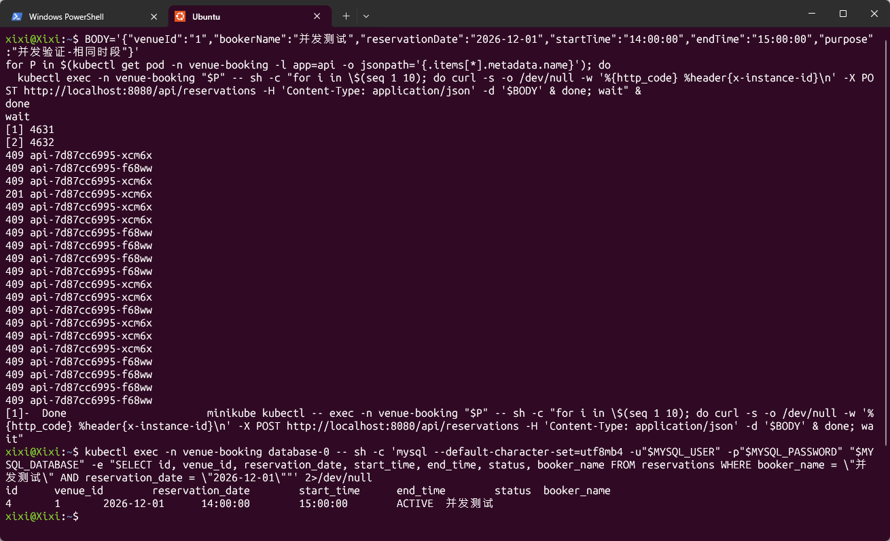
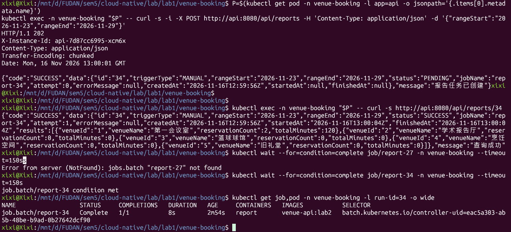
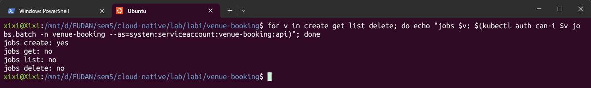
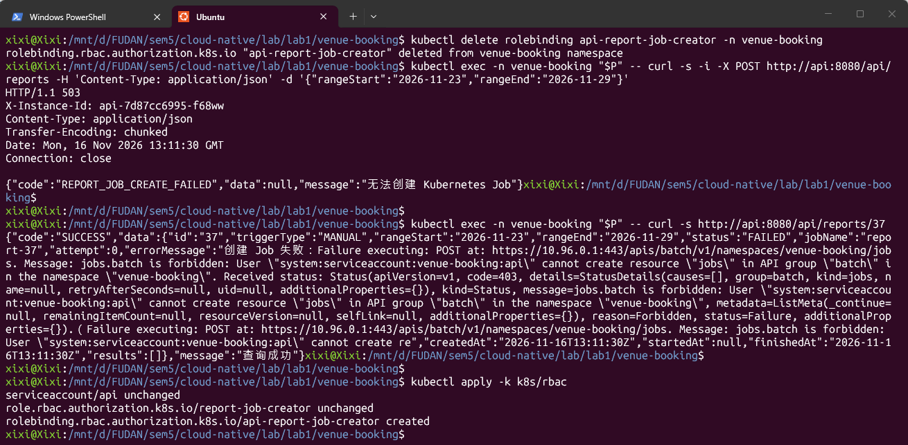
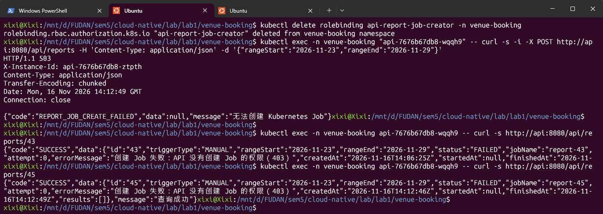
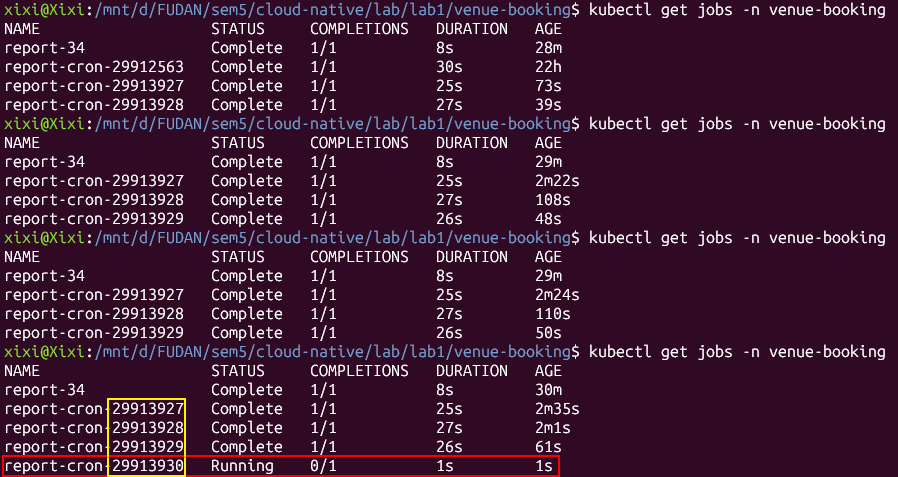
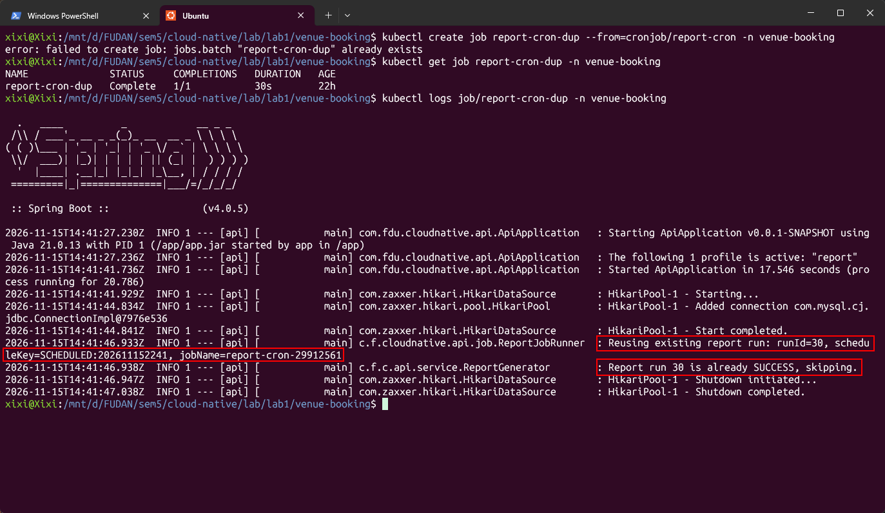

# Lab 2 验证证据

本目录保存 Lab 2 的验证过程和结果，对应实验报告中的各项验证。每一项由负责人执行、填写本文件对应小节，并把原始输出或截图放进同编号的子目录。

## 总览

| 编号 | 验证项               | 负责人   | 子目录               | 状态    |
|----|-------------------|-------|-------------------|-------|
| 01 | API 多副本与 Pod 自愈   | 数据库同学 | `01-replicas/`    | ⬜ 未开始 |
| 02 | 多副本下的并发预约         | 后端    | `02-concurrency/` | ✅ 通过  |
| 03 | 手动触发报告 Job（含失败路径） | 后端    | `03-job/`         | ✅ 通过  |
| 04 | CronJob 定时报告      | 后端    | `04-cronjob/`     | ✅ 通过  |
| 05 | 数据库持久化            | 数据库同学 | `05-persistence/` | ⬜ 未开始 |
| 06 | 前端页面与 DaemonSet | 前端 | 见 [`lab2-frontend-evidence.md`](../lab2-frontend-evidence.md) | 以该文件为准 |

状态用：⬜ 未开始 / 🟡 进行中 / ✅ 通过 / ❌ 未通过（写明原因）。

## 填写约定

- **文件命名**：`<两位序号>-<说明>.txt` 或 `.png`，例如 `03-job/02-job-log.txt`。序号按执行顺序排。
- **命令输出**：直接重定向保存原文，不要手动删改；需要说明的地方写在本文件里。
- **截图**：放进子目录后在本文件里引用，例如 ``。
- **每一项都要写**：执行时间、执行人、实际结果、结论。结果和预期不一致也照实写。
- **不要提交任何密码**：不要保存 `kubectl get secret -o yaml` 的输出、`.env` 的内容，或带有密码的命令行。截图前检查终端里有没有密码。
- 下面给出的命令是参考，在 WSL 里、仓库根目录执行；实际用了别的命令就把实际的写上。
- 在容器里用 `mysql` 命令行查询时加上 `--default-character-set=utf8mb4`，否则中文会显示成问号，按中文条件筛选也匹配不到。

## 环境信息

执行验证前填写一次，环境变了再更新。

| 项目            | 值                                                                              |
|---------------|--------------------------------------------------------------------------------|
| 集群            | minikube，profile `k8s-lab`，3 个节点（1 个控制面 + 2 个 worker），docker 驱动，containerd 运行时 |
| Kubernetes 版本 | 服务端 v1.37.0，kubectl v1.34.1（见 `00-version.txt`）                                |
| 节点列表          | `k8s-lab`、`k8s-lab-m02`、`k8s-lab-m03`，见 `00-nodes.txt`                         |
| 命名空间          | `venue-booking`                                                                |
| API 镜像        | `venue-api:lab2`                                                               |
| 前端镜像          | （前端填写；02–04 验证时前端尚未部署）                                                         |
| 代码版本（commit）  | `8185464`（`main`）                                                              |
| 验证日期          | 02–04：2026-11-15                                                               |

02–04 是在后端同学本机的集群上做的，当时库里已有之前联调留下的数据（1 条预约、26 条报告记录），所以记录 id 不是从 1 开始。01、05、06 如果在别的环境执行，请在各自小节写明。

```bash
kubectl version > docs/evidence/00-version.txt
```

```bash
kubectl get nodes -o wide > docs/evidence/00-nodes.txt
```

```bash
kubectl get all,pvc,cm,sa,role,rolebinding,cronjob -n venue-booking > docs/evidence/00-resources.txt
```

## 01 API 多副本与 Pod 自愈

- 负责人：数据库
- 执行时间：
- 状态：⬜

**要证明什么**

1. API 有 2 个副本，都处于就绪状态。
2. 通过 Service 访问时，两个副本都处理了请求。
3. 删掉一个 API Pod 后，Deployment 自动补回，服务不中断。

**通过标准**

- `kubectl get deploy api` 显示 `2/2`。
- 连续请求的响应头 `X-Instance-Id` 中，两个 Pod 名都出现。
- 删除 Pod 后出现一个新的 Pod 名，最终回到 `2/2`。

**参考命令**

```bash
kubectl get deploy,pods -n venue-booking -l app=api -o wide > docs/evidence/01-replicas/01-pods.txt
```

经 Service 连续请求 20 次，统计每个实例处理了几次（API 镜像里自带 curl）：

```bash
P=$(kubectl get pod -n venue-booking -l app=api -o jsonpath='{.items[0].metadata.name}')
kubectl exec -n venue-booking "$P" -- sh -c 'for i in $(seq 1 20); do curl -s -o /dev/null -D - http://api:8080/api/venues | grep -i x-instance-id; done | sort | uniq -c' > docs/evidence/01-replicas/02-instance-distribution.txt
```

自愈：删掉一个 Pod，观察重建过程（另开一个终端先执行 watch）：

```bash
kubectl get pods -n venue-booking -l app=api -w
```

```bash
kubectl delete pod -n venue-booking "$(kubectl get pod -n venue-booking -l app=api -o jsonpath='{.items[0].metadata.name}')"
```

```bash
kubectl get pods -n venue-booking -l app=api -o wide > docs/evidence/01-replicas/03-pods-after-delete.txt
```

**实际结果**

（填写：两个 Pod 名、各自处理的请求数、被删的 Pod 名和新 Pod 名、恢复用时）

**证据文件**

- `01-replicas/01-pods.txt`
- `01-replicas/02-instance-distribution.txt`
- `01-replicas/03-pods-after-delete.txt`

**结论**

## 02 多副本下的并发预约

- 负责人：后端
- 执行时间：2026-11-15 22:38（CST）
- 执行人：后端
- 状态：✅ 通过

**要证明什么**

两个 API 副本同时收到对同一场地、时间重叠的预约请求时，只有一个成功，数据库里不会出现冲突的预约。

**通过标准**

- 一批并发请求中，恰好 1 个返回 `201`，其余返回 `409 RESERVATION_CONFLICT`。
- 被拒绝的请求里有来自另一个 Pod 的（看 `X-Instance-Id`），说明冲突是在数据库层面拦住的，而不是单个进程内。
- 数据库中该场地该时段的 `ACTIVE` 预约只有 1 条。

**执行的命令**

分别进入两个 API Pod，各自对本机 `localhost:8080` 同时发 10 个请求，这样能确定两个副本都参与了竞争。每个响应记录状态码和处理它的实例。

第一轮，两个副本提交完全相同的时段（场地 1，2026-11-25 14:00–15:00）：

```bash
BODY='{"venueId":"1","bookerName":"并发测试","reservationDate":"2026-11-25","startTime":"14:00:00","endTime":"15:00:00","purpose":"并发验证-相同时段"}'
for P in $(kubectl get pod -n venue-booking -l app=api -o jsonpath='{.items[*].metadata.name}'); do
  kubectl exec -n venue-booking "$P" -- sh -c "for i in \$(seq 1 10); do curl -s -o /dev/null -w '%{http_code} %header{x-instance-id}\n' -X POST http://localhost:8080/api/reservations -H 'Content-Type: application/json' -d '$BODY' & done; wait" > "docs/evidence/02-concurrency/01-same-slot-$P.txt" 2>&1 &
done; wait
```

第二轮，两个副本提交部分重叠的时段（场地 1，2026-11-26，一边 14:00–15:00，另一边 14:30–15:30），命令相同，只是两个 Pod 用不同的请求体，输出到 `03-overlap-<pod>.txt`。

汇总和查库：

```bash
cat docs/evidence/02-concurrency/01-same-slot-*.txt | sort | uniq -c > docs/evidence/02-concurrency/02-same-slot-summary.txt
```

```bash
kubectl exec -n venue-booking database-0 -- sh -c 'mysql --default-character-set=utf8mb4 -u"$MYSQL_USER" -p"$MYSQL_PASSWORD" "$MYSQL_DATABASE" -e "SELECT id, venue_id, reservation_date, start_time, end_time, status, booker_name FROM reservations WHERE booker_name = \"并发测试\" ORDER BY id"' 2>/dev/null > docs/evidence/02-concurrency/05-db-rows.txt
```

**实际结果**

两轮各 20 个请求，结果相同：

| 轮次   | 201 | 409 | 成功的请求由谁处理              | 另一个 Pod                           |
|------|-----|-----|------------------------|-----------------------------------|
| 相同时段 | 1   | 19  | `api-7d87cc6995-f68ww` | `api-7d87cc6995-xcm6x`：10 个全部 409 |
| 部分重叠 | 1   | 19  | `api-7d87cc6995-f68ww` | `api-7d87cc6995-xcm6x`：10 个全部 409 |

数据库里"并发测试"的预约只有 2 条，每轮 1 条，都是 `ACTIVE`：

```
id  venue_id  reservation_date  start_time  end_time  status  booker_name
2   1         2026-11-25        14:00:00    15:00:00  ACTIVE  并发测试
3   1         2026-11-26        14:00:00    15:00:00  ACTIVE  并发测试
```

第二轮里 14:30–15:30 的请求全部被拒，说明拦住的是"时间重叠"，不只是"完全相同"。

**说明**

- 同一个 Pod 内的 10 个请求是真正并发的。两个 Pod 的请求由两条 `kubectl exec` 分别发起，启动时间有几十到几百毫秒的差异，不能保证跨 Pod 精确同时到达。
- 即便如此，`xcm6x` 的请求被拒绝，依据的是 `f68ww` 写入的预约，这只能通过数据库判断，证明冲突检查不依赖单个进程的内存状态。

**截图**



**证据文件**

- `02-concurrency/01-same-slot-<pod>.txt`、`02-same-slot-summary.txt`
- `02-concurrency/03-overlap-<pod>.txt`、`04-overlap-summary.txt`
- `02-concurrency/05-db-rows.txt`

**结论**

通过。多副本下重叠预约只成功一个，数据库中没有冲突记录。

## 03 手动触发报告 Job（含失败路径）

- 负责人：后端
- 执行时间：2026-11-15 22:38–22:39（CST）
- 执行人：后端（AI 助手协同执行）
- 状态：✅ 通过

**要证明什么**

1. 调用 `POST /api/reports` 后，API 通过 Kubernetes API 创建了 Job，Job 运行成功，报告记录从 `PENDING` 变为 `SUCCESS`，结果与预约数据一致。
2. Job 带有任务标识、重试次数和超时设置。
3. API 只拥有创建 Job 的最小权限。
4. 创建 Job 失败时，接口返回 503，记录为 `FAILED` 并带有原因，失败可追踪。

**通过标准**

- 接口返回 `202`，`jobName` 为 `report-<id>`。
- `kubectl get job report-<id>` 为 `Complete`；Pod 日志有开始和完成两行。
- `GET /api/reports/<id>` 状态为 `SUCCESS`，每个场地一行结果。
- Job 的 `backoffLimit`、`activeDeadlineSeconds`、`ttlSecondsAfterFinished` 有值。
- `kubectl auth can-i`：`create jobs` 为 yes，其余为 no。
- 失败路径：接口 `503 REPORT_JOB_CREATE_FAILED`，记录 `FAILED`，`errorMessage` 说明原因。

**执行的命令**

成功路径（统计范围 2026-11-23 至 2026-11-29，包含 02 中写入的两条预约）：

```bash
P=$(kubectl get pod -n venue-booking -l app=api -o jsonpath='{.items[0].metadata.name}')
kubectl exec -n venue-booking "$P" -- curl -s -i -X POST http://api:8080/api/reports -H 'Content-Type: application/json' -d '{"rangeStart":"2026-11-23","rangeEnd":"2026-11-29"}' > docs/evidence/03-job/01-create-response.txt
```

本次返回的 id 是 27，下面的命令里换成实际的 id：

```bash
kubectl exec -n venue-booking "$P" -- curl -s http://api:8080/api/reports/27 > docs/evidence/03-job/02-detail-right-after-create.json
```

```bash
kubectl wait --for=condition=complete job/report-27 -n venue-booking --timeout=150s
```

```bash
kubectl get job,pod -n venue-booking -l run-id=27 -o wide > docs/evidence/03-job/03-job-status.txt
```

```bash
kubectl get job report-27 -n venue-booking -o yaml > docs/evidence/03-job/04-job.yaml
```

```bash
kubectl logs job/report-27 -n venue-booking > docs/evidence/03-job/05-job-log.txt
```

```bash
kubectl exec -n venue-booking "$P" -- curl -s http://api:8080/api/reports/27 > docs/evidence/03-job/06-report-detail.json
```

用 SQL 直接统计同一范围内的预约，和报告结果对照，保存为 `07-reservations-in-range.txt`。

最小权限：

```bash
for v in create get list delete; do echo "jobs $v: $(kubectl auth can-i $v jobs.batch -n venue-booking --as=system:serviceaccount:venue-booking:api)"; done > docs/evidence/03-job/08-rbac.txt
```

失败路径（临时去掉 RoleBinding，验证完**必须恢复**）：

```bash
kubectl delete rolebinding api-report-job-creator -n venue-booking
```

```bash
kubectl exec -n venue-booking "$P" -- curl -s -i -X POST http://api:8080/api/reports -H 'Content-Type: application/json' -d '{"rangeStart":"2026-11-23","rangeEnd":"2026-11-29"}' > docs/evidence/03-job/09-failure-response.txt
```

```bash
kubectl exec -n venue-booking "$P" -- curl -s http://api:8080/api/reports/28 > docs/evidence/03-job/10-failure-record.json
```

```bash
kubectl apply -k k8s/rbac
```

**实际结果**

成功路径：

| 检查点     | 结果                                                                                                                                     |
|---------|----------------------------------------------------------------------------------------------------------------------------------------|
| 创建接口    | `202`，由 `api-7d87cc6995-xcm6x` 处理，返回 id 27、`jobName` 为 `report-27`                                                                     |
| 创建后立即查询 | `PENDING`                                                                                                                              |
| Job     | `report-27`，`Complete 1/1`，用时 9 秒                                                                                                      |
| Job 设置  | `backoffLimit: 2`、`activeDeadlineSeconds: 300`、`ttlSecondsAfterFinished: 3600`，标签 `run-id: "27"`，`automountServiceAccountToken: false` |
| Job 日志  | 以 `report` profile 启动；`Generating report: runId=27, range=2026-11-23..2026-11-29, attempt=1`；`Report generated: runId=27, rows=5`      |
| 完成后查询   | `SUCCESS`，`attempt` 为 1，5 个场地各一行                                                                                                       |
| 与预约数据对照 | 报告：场地 1 为 2 次、120 分钟，其余场地为 0。SQL 直接统计：场地 1 有 2 条、120 分钟。两者一致                                                                           |

最小权限（`api` 这个 ServiceAccount）：

```
jobs create: yes
jobs get: no
jobs list: no
jobs delete: no
secrets get: no
pods list: no
jobs create (namespace default): no
```

失败路径（2026-11-16 在错误信息修复后重新执行）：

| 检查点 | 结果 |
|---|---|
| 创建接口 | `503`，`code` 为 `REPORT_JOB_CREATE_FAILED`，由 `api-7676b67db8-wqqh9` 处理 |
| 记录 | id 43，`FAILED`，`attempt` 为 0，`errorMessage` 为 `创建 Job 失败：API 没有创建 Job 的权限（403）` |
| 集群里 | 没有 `report-43` 这个 Job（`NotFound`） |
| API 日志 | 有一条 `WARN 创建报告 Job 失败，runId=43`，其 `Caused by` 保留了 Kubernetes 返回的完整原因（`jobs.batch is forbidden: User "system:serviceaccount:venue-booking:api" cannot create resource "jobs" …`） |
| 恢复 | 重新 `apply -k k8s/rbac` 后，`jobs create` 回到 yes；随后再触发一次，Job `report-44` 正常完成 |

记录里的 `errorMessage` 会显示在页面上，所以只说明是哪一类问题（没有权限、同名 Job 已存在、命名空间不存在、无法连接 Kubernetes API 等），不包含集群内部地址和账号名。排查时用记录 id 到 API 日志里找对应的 `WARN`，完整原因在那里。

2026-11-15 第一次执行时（记录 id 28），`errorMessage` 是 Kubernetes 客户端的原始信息，内容很长并且带有集群内部地址，之后已修复。`03-rbac-failure-record.png` 是修复前截的，上面还是旧的长信息；修复后的截图是 `03-rbac-failure-record-simplified.png`。

**证据文件**

- `03-job/01-create-response.txt` 至 `07-reservations-in-range.txt`：成功路径
- `03-job/08-rbac.txt`：权限检查
- `03-job/09-failure-response.txt` 至 `13-api-log-failure.txt`：失败路径与恢复

**截图**

手动创建 Job 后，Job 状态：



rbac 检查：



rbac 失败后，创建 Job 接口返回 503（**修复前，返回完整异常堆栈给用户**）：



rbac 失败后，创建 Job 接口返回 503（**修复后，仅返回简短信息给用户**）



**结论**

通过。手动触发能创建并完成 Job，结果与预约数据一致；创建失败时接口返回 503，记录、错误信息和 API 日志三处都能追踪到原因。

没有覆盖的情况：Job 已创建但运行中失败并按 `backoffLimit` 重试（这部分只有单元测试和本地模拟，没有在集群上制造）。

## 04 CronJob 定时报告

- 负责人：后端
- 执行时间：2026-11-15 22:39–22:43（CST）
- 执行人：后端
- 状态：✅ 通过

**要证明什么**

1. CronJob 按周期自动创建 Job 并生成 `SCHEDULED` 报告，不需要人工触发。
2. 配置了周期、时区、并发策略和历史保留数量。
3. 同一计划时刻重复执行不会产生第二份报告。

**通过标准**

- CronJob 的时区为 `Asia/Shanghai`，`concurrencyPolicy` 为 `Forbid`，有历史保留数量。
- 演示周期下连续几分钟各出现一个 `report-cron-<时间戳>` Job，都为 `Complete`。
- `report_runs` 中每个 Job 对应一条 `SCHEDULED` 记录，`schedule_key` 互不相同，`job_name` 为 Job 名。
- 对同一个 `schedule_key` 再执行一次，记录数不增加。

**执行的命令**

切换到演示周期（每分钟一次）：

```bash
kubectl apply -k k8s/jobs/report-cron-demo
```

```bash
kubectl get cronjob report-cron -n venue-booking -o yaml > docs/evidence/04-cronjob/01-cronjob.yaml
```

防重复：在一个计划 Job 刚启动后，从同一个 CronJob 手动再创建一个 Job，让两者落在同一分钟：

```bash
kubectl create job report-cron-dup --from=cronjob/report-cron -n venue-booking
```

观察约 3 分钟后收集结果：

```bash
kubectl get jobs -n venue-booking -l trigger=scheduled > docs/evidence/04-cronjob/04-jobs.txt
```

```bash
kubectl logs job/report-cron-dup -n venue-booking > docs/evidence/04-cronjob/07-same-minute-duplicate-job-log.txt
```

查询本次验证期间新增的记录（id 大于 28），以及每个 `schedule_key` 对应几条记录，保存为 `05-scheduled-runs.txt` 和 `08-records-per-key.txt`。

验证完恢复为每日一次：

```bash
kubectl apply -k k8s/jobs/report-cron
```

**实际结果**

CronJob 配置（演示周期下导出）：`schedule: '*/1 * * * *'`、`timeZone: Asia/Shanghai`、`concurrencyPolicy: Forbid`、`successfulJobsHistoryLimit: 3`、`failedJobsHistoryLimit: 3`、`startingDeadlineSeconds: 300`；Job 模板 `backoffLimit: 2`、`activeDeadlineSeconds: 300`。

连续三分钟自动产生的记录：

```
id  trigger_type  range_start  range_end   status   job_name              schedule_key            attempt
29  SCHEDULED   2026-11-09   2026-11-15  SUCCESS  report-cron-29912560  SCHEDULED:202611152240  1
30  SCHEDULED   2026-11-09   2026-11-15  SUCCESS  report-cron-29912561  SCHEDULED:202611152241  1
32  SCHEDULED   2026-11-09   2026-11-15  SUCCESS  report-cron-29912562  SCHEDULED:202611152242  1
```

- 统计窗口是最近 7 天（含当天）：2026-11-09 至 2026-11-15。
- `job_name` 与集群里的 Job 名一致，`schedule_key` 精确到分钟且互不相同。
- 每个计划 Job 用时 27–29 秒，状态 `Complete`。

防重复：

- 22:41:20 手动创建 `report-cron-dup`，它和计划 Job `report-cron-29912561` 落在同一分钟。
- `report-cron-dup` 的日志：
  `Reusing existing report run: runId=30, scheduleKey=SCHEDULED:202611152241, jobName=report-cron-29912561`，接着 `Report run 30 is already SUCCESS, skipping.`，Job 以成功结束。
- 每个 `schedule_key` 都只有 1 条记录，`SCHEDULED:202611152241` 没有出现第二条。
- 记录 id 从 30 跳到 32：31 是那次被唯一键拒绝的插入消耗掉的自增值，这也说明重复插入确实发生并被数据库拦下。
- 记录 30 的 `attempt` 仍是 1，结果没有被重算。

恢复：重新 `apply -k k8s/jobs/report-cron` 后，周期回到 `0 2 * * *`。

**说明**

- `report-cron-29912560` 的 Job 在收集证据时已被 `successfulJobsHistoryLimit: 3` 清理，所以 `04-jobs.txt`
  里没有它，它的日志也没有保存；它对应的数据库记录（id 29）还在。这同时说明历史保留数量在起作用。
- 恢复为每日周期前，22:43 的计划 Job（`report-cron-29912563`）已经启动，所以库里还会多一条 `SCHEDULED:202611152243`
  的记录，不在上表中。
- `schedule_key` 取的是程序实际启动的时刻。Pod 启动约需 20 多秒，如果某次启动延迟超过一分钟，key 会落到下一分钟。

**截图**

临时将 CronJob 改为每分钟一次，连续三分钟产生的 Job(Complete) 以及一个正在运行的 Job(Running)，根据 limit 设置，更早的 Job 已被清理：



同一时间重复执行的 Job 日志，显示复用已有记录并跳过和返回成功：



**证据文件**

- `04-cronjob/01-cronjob.yaml`、`02-cronjob-status-start.txt`：CronJob 配置
- `04-cronjob/03-jobs-watch.txt`、`04-jobs.txt`：Job 的产生过程和最终状态
- `04-cronjob/05-scheduled-runs.txt`、`08-records-per-key.txt`：数据库记录
- `04-cronjob/06-scheduled-job-log.txt`、`07-same-minute-duplicate-job-log.txt`：计划 Job 与重复 Job 的日志
- `04-cronjob/09-scheduled-report-detail.json`：一条定时报告的接口返回
- `04-cronjob/10-cronjob-restored.txt`：恢复为每日周期

**结论**

通过。CronJob 自动产生报告，同一计划时刻重复执行不会产生第二份。

没有覆盖的情况：`concurrencyPolicy: Forbid` 的实际跳过行为没有单独制造（需要让一次任务运行超过一个周期）；每日周期（02: 00）没有等到真实触发，只验证了演示周期。

## 05 数据库持久化

- 负责人：数据库
- 执行时间：
- 状态：⬜

**要证明什么**

删除 `database-0` 后，StatefulSet 重建同名 Pod 并挂回原来的 PVC，之前写入的数据仍然存在。

**通过标准**

- 删除前后 PVC `data-database-0` 是同一个（`VOLUME` 列不变）。
- 重建后的 Pod 名仍是 `database-0`。
- 删除前写入的一条预约，重建后还能查到；初始化脚本没有重复执行（种子数据行数不变）。
- 数据库恢复后，API 的就绪探针恢复为就绪，接口可用。

**参考命令**

```bash
kubectl get pod,pvc -n venue-booking -l app=database -o wide > docs/evidence/05-persistence/01-before.txt
```

```bash
kubectl exec -n venue-booking database-0 -- sh -c 'mysql --default-character-set=utf8mb4 -u"$MYSQL_USER" -p"$MYSQL_PASSWORD" "$MYSQL_DATABASE" -e "SELECT COUNT(*) AS venues FROM venues; SELECT COUNT(*) AS reservations FROM reservations; SELECT COUNT(*) AS report_runs FROM report_runs"' 2>/dev/null > docs/evidence/05-persistence/02-counts-before.txt
```

```bash
kubectl delete pod database-0 -n venue-booking
```

```bash
kubectl wait --for=condition=ready pod/database-0 -n venue-booking --timeout=180s
```

```bash
kubectl get pod,pvc -n venue-booking -l app=database -o wide > docs/evidence/05-persistence/03-after.txt
```

```bash
kubectl exec -n venue-booking database-0 -- sh -c 'mysql --default-character-set=utf8mb4 -u"$MYSQL_USER" -p"$MYSQL_PASSWORD" "$MYSQL_DATABASE" -e "SELECT COUNT(*) AS venues FROM venues; SELECT COUNT(*) AS reservations FROM reservations; SELECT COUNT(*) AS report_runs FROM report_runs"' 2>/dev/null > docs/evidence/05-persistence/04-counts-after.txt
```

**实际结果**

（填写：删除前后的行数、PVC 名和卷名、Pod 恢复用时、API 是否自动恢复）

**证据文件**

- `05-persistence/01-before.txt` … `04-counts-after.txt`

**结论**

## 06 前端页面与 DaemonSet

- 负责人：前端
- 记录位置：[`docs/lab2-frontend-evidence.md`](../lab2-frontend-evidence.md)

前端的验证清单、实际结果和截图由前端同学在上面这个文件里维护，本文件不重复记录。那份清单包含：

- F01–F09：页面功能，包括触发报告、状态变化、成功与失败的报告详情、轮询、深链刷新。
- K01–K03：前端 Deployment 与 Service、Pod 删除后自动重建、Nginx 配置由 ConfigMap 挂载并代理到 `api:8080`。
- D01–D02：`node-check` DaemonSet 在各节点的分布和检查日志。

其中报告详情页的数字可以和本目录的 `03-job/06-report-detail.json` 对照。

## 遗留问题

验证中发现但没有解决的问题记在这里，写明现象、影响和打算怎么处理。

| 编号 | 现象 | 影响 | 处理 |
|----|----|----|----|
|    |    |    |    |
